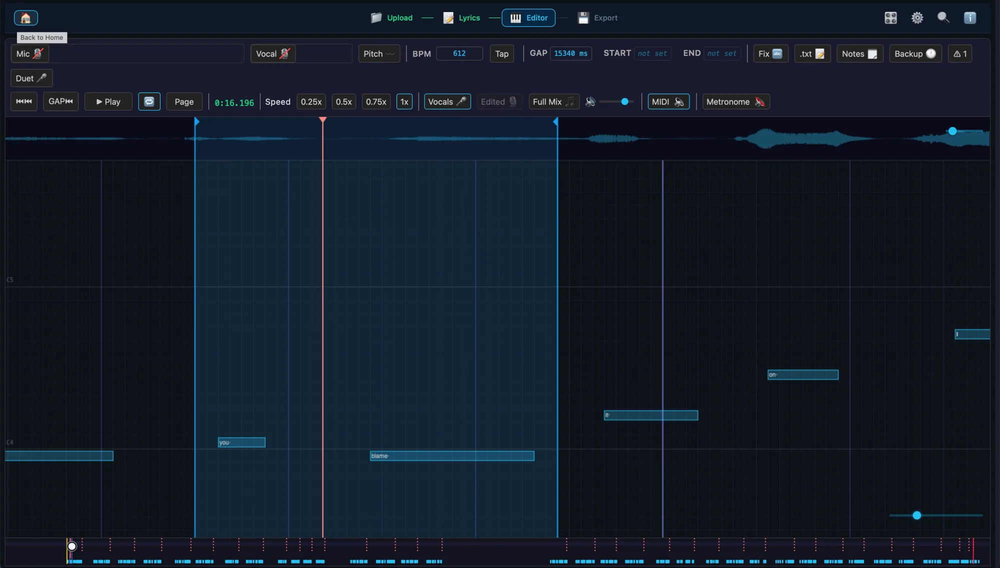

  

<h1 align="center">Ultrastar Creator Tool</h1>

<b>Create UltraStar songs with the help of AI.</b> 
Upload a song or add a link to a song on YouTube, and create an UltraStar song with a little help from AI.

  <a href="https://retotito.github.io/UltrastarCreatorTool/"><b>Website</b></a> ·
  <a href="https://retotito.github.io/UltrastarCreatorTool/#download"><b>Download</b></a> ·
  <a href="https://github.com/retotito/UltrastarCreatorTool/issues/new/choose">Report a problem or idea</a>

  
  
  

---

## Download

**[⬇ Download the latest version](https://github.com/retotito/UltrastarCreatorTool/releases/latest)**: choose your
file under "Assets".

| Computer | File | Needs |
|----------|------|-------|
| Mac with Apple Silicon | `..._aarch64.dmg` | macOS 14 or newer |
| Mac with Intel | `..._x86_64.dmg` | macOS 12 or newer |
| Windows | `....msi` | 64-bit Windows |

The first start downloads the AI models, about **3.5 GB**. After that, the app offers new versions by itself; your
songs and models stay.

The app isn't code-signed yet, so your system warns you the first time:

- **macOS:** drag the app to Applications and open it. When macOS blocks it, go to **System Settings → Privacy &
  Security** and click **Open Anyway**.
- **Windows:** when SmartScreen warns you, click **More info**, then **Run anyway**.

**Coming from a version before 5.0?** Export the songs you want to keep as a ZIP, close and uninstall the old app, then
install this one.

## What's new in 5.0

- **Duets:** duet songs stay intact, both singers are shown, and you edit one at a time
- **YouTube:** paste a link instead of uploading a file, use its subtitles as lyrics, and export the video
- **Export:** a song folder ready for the game, or a `.txt` in USDB's format
- **Better results:** on six test songs, misplaced syllables dropped from 57 % to 7 %; a new model finds the notes
- **Better vocal separation:** an optional slower model, much cleaner where voices overlap
- **Automatic updates:** the app offers new versions and shows what's new

See the [full feature list](docs/features/overview.md) and the [CHANGELOG](CHANGELOG.md).

## Video tutorials

These show earlier versions, so some screens look different.

- [Overview: getting started](https://www.youtube.com/watch?v=zKw03mhrYX8&t=5s)
- [Pitch line, vocal tracing and sing along](https://www.youtube.com/watch?v=p4ihQaDhwfg)
- [Looping and scrubbing](https://www.youtube.com/watch?v=WwAZQlhqSwE&t=2s)
- [BPM and metronome](https://www.youtube.com/watch?v=L8jnov5M-XY)
- [AI limits and workarounds](https://www.youtube.com/watch?v=WOKcdjpthh0)

## Something went wrong?

The backend log shows every processing step and error:

- **macOS:** `~/Library/Logs/com.ultrastar.creator/backend.log`
- **Windows:** `%LOCALAPPDATA%\com.ultrastar.creator\logs\backend.log`

Please [open an issue](https://github.com/retotito/UltrastarCreatorTool/issues) and attach it.

## Licence

The app is free and open source under the [GPL-3.0](LICENSE). Its BPM detection uses Essentia, which stays under the
AGPL-3.0. The licence doesn't cover the AI models: some, including the aligner and the note model, are **free for
non-commercial use only**. See [AI models](docs/architecture/ai-models.md) for all of them and their licences.

## Development

[CONTRIBUTING.md](CONTRIBUTING.md) covers setup, tests and conventions; [docs/](docs/README.md) covers the architecture
and the build guides.
